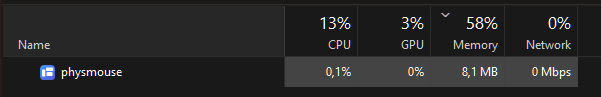

# **Disclaimer | SmartScreen & Antivirus** 
This release is unsigned, so Windows and/or Third-Party Antivirus Software (Bitdefender Web Protection flagged the file download for me) may show a warning that it is not safe to download or run. Download only from the official GitHub release and compare its SHA-256 with the value published alongside that release.

# physmouse

<a href="https://apps.microsoft.com/detail/9P31NQHKW1NR"></a> <a href="https://alternativeto.net/software/physmouse/about/?utm_source=badge&utm_medium=referral"></a>

Windows lines your screens up by their pixels. If your screens differ in size, resolution or height on the desk, the cursor jumps up or down as it crosses from one to the next, or gets stuck where the pixel edges don't line up.

physmouse fixes that. You tell it where your screens actually sit on your desk, and it moves the cursor between them by real distance, so it leaves one screen and enters the next at the same physical spot.

## Features

- **Layout editor.** Drag screens to where they sit, or type exact positions and sizes in millimetres or inches. Edges snap to each other (hold Alt to place freely). Arrow keys nudge the selected screen by 1 mm, or by 10 mm with Shift. Physical sizes come from each screen's EDID, so you usually only need to arrange them.
- **Live cursor preview.** The editor shows where your cursor is in the layout you're editing, before you apply it.
- **Identify.** Shows a big number on every screen, so you can tell which tile is which.
- **Gaps and offsets.** Screens don't have to touch. Moving across a gap takes the cursor straight to the screen on the other side.
- **Edge behaviour.** Where there's no screen beyond an edge, the cursor either stops there or falls back to Windows' own layout.
- **Edge resistance.** Optionally require a short push past an edge before the cursor crosses, which keeps it from slipping off while you reach for a scroll bar.
- **Bypass key.** Hold Shift, Ctrl or Alt to cross the way Windows normally would.
- **Full-screen lock.** Choose which open apps keep the cursor on their screen in full-screen mode. No apps are selected by default.
- **On/off shortcut.** A global keyboard shortcut that pauses and resumes remapping.
- **Start with Windows.** Off by default; turn it on during setup or under General.
- **Remembers every screen.** Layouts are stored per physical screen, so unplugging a screen and plugging it back in keeps its place. When a new screen is connected, physmouse asks you to place it.
- Follows Windows' light or dark mode and your accent colour.

## Resource usage

physmouse stays out of the way in the background: about 0.1% CPU, around 8 MB of memory and no network traffic apart from an update check at startup, in Task Manager (measured on an AMD Ryzen 7 9850X3D, 32 GB DDR5-6000 CL36, Windows 11 26H2). It only steps in when the cursor crosses a screen edge.



## Install

The easiest way is the [Microsoft Store](https://apps.microsoft.com/detail/9P31NQHKW1NR), which installs and updates physmouse for you. Like the GitHub version, it only starts with Windows once you turn that on under **General > Start with Windows**. To install it from GitHub instead:

1. Download `physmouse-v<version>-installer.exe` from the [latest release](../../releases/latest) and run it. Releases are built by GitHub Actions from the tagged commit. To check that your download is that build, run `gh attestation verify physmouse-v<version>-installer.exe -R lieberlenny/physmouse`, or compare its SHA-256 with the one in the release notes.
2. Click **Install**. physmouse installs for your user account only, into `%LOCALAPPDATA%\Programs\physmouse`. You can change the folder and choose whether it starts with Windows (off by default) and gets a desktop shortcut.
3. Open physmouse and complete the tutorial. The layout editor shows your screens placed as Windows has them.
4. Drag them to match your desk and click **Apply**.

physmouse runs in the notification area. Click its icon, or open it again from Start, to bring back the window.

To update, download the new `physmouse.exe` and run it. It offers to replace the installed version and keeps your settings and layout.

To uninstall, use Settings > Apps > Installed apps, or **Uninstall** on physmouse's About page. You can choose to keep your settings for a later reinstall.

If you'd rather not install anything, choose **Run portable** instead. physmouse then keeps its settings next to the exe and doesn't touch the Start menu or startup entries until you turn them on.

It needs Windows 10 or 11 and the .NET Framework 4.8, which is part of Windows.

## Settings file

Everything is stored in `%APPDATA%\physmouse\settings.ini`, a plain-text file that's easy to back up or copy to another PC. For a portable setup, put an empty `settings.ini` next to `physmouse.exe` and physmouse will use that instead.

The screen id is the EDID product code plus the port the screen is connected to. If a screen moves to another port or the graphics driver renumbers it, physmouse still matches it by product code, as long as you don't have two identical screens.

## How it works

physmouse installs a low-level mouse hook on its own high-priority thread. When a mouse movement would take the cursor off its current screen, physmouse converts the exit point to millimetres on the desk, finds the screen across from it, and places the cursor at the matching point there. Movement within a screen passes straight through untouched.

The hook only sees input that Windows lets it see. Windows doesn't pass mouse input to a normal app's hook while an app running as administrator (such as Task Manager) is in front, so physmouse can't remap the cursor then. Windows' own pixel layout applies until you switch to another window.

**Why there's no "run as administrator" option anymore.** Up to 1.3.0, physmouse could start with administrator rights at sign-in through a Task Scheduler task. That task ran `physmouse.exe` from the per-user install folder, which any program running as you can write to without administrator rights. Malware could have replaced the exe and then been started with full rights at the next sign-in, without a UAC prompt. The option is gone, and an existing task is removed: the next time it starts physmouse at sign-in, physmouse deletes it and adds a normal startup entry instead. If you need remapping over elevated windows for a while, quit physmouse and start it with **Run as administrator**; that copy runs until you quit it or sign out.

## Security & enterprise

<a href="https://scorecard.dev/viewer/?uri=github.com/lieberlenny/physmouse"></a>

This section is for anyone reviewing physmouse before rolling it out, for example through Intune. To report a vulnerability, see [SECURITY.md](SECURITY.md). What changed between versions is in [CHANGELOG.md](CHANGELOG.md).

### What the mouse hook does

- physmouse installs a low-level **mouse** hook (`WH_MOUSE_LL`). It acts only on cursor movement that leaves a screen. Clicks, the wheel and movement within a screen pass through untouched. Nothing is logged or stored.
- There is **no keyboard hook**. The only keyboard state physmouse reads is whether the bypass key you chose (Shift, Ctrl or Alt) is held. The on/off shortcut is a normal registered hotkey (`RegisterHotKey`).
- For the full-screen lock, the hook checks the foreground window's process name and size. Window titles are read only to list open apps in **Choose apps**, and only locally. They are never stored or sent. Only the process names you select are saved, in `settings.ini`.

### Network

- GitHub version: one HTTPS `HEAD` request to `github.com/lieberlenny/physmouse/releases/latest` at startup, to see whether a newer release exists. It sends nothing except the app version in the User-Agent. The `DisableUpdateCheck` policy turns it off.
- Microsoft Store version: no network requests at all. The Store handles updates.
- Both versions: if the `DefaultSettings` policy points to a network share (UNC path), Windows reads that file over SMB on the first start.

### What is written where

| What | Where | When |
|---|---|---|
| Program | `%LOCALAPPDATA%\Programs\physmouse\physmouse.exe` (or the folder chosen during setup) | install |
| Apps & features entry | `HKCU\Software\Microsoft\Windows\CurrentVersion\Uninstall\physmouse` | install |
| Start menu shortcut, optional desktop shortcut | `%APPDATA%\Microsoft\Windows\Start Menu\Programs\physmouse.lnk`, `Desktop\physmouse.lnk` | install |
| Settings and layout | `%APPDATA%\physmouse\settings.ini`, or `settings.ini` next to the exe in portable mode (Store: the package's `LocalCache\Roaming\physmouse`) | first start, every change |
| Start with Windows | value `physmouse` under `HKCU\Software\Microsoft\Windows\CurrentVersion\Run` and `...\Explorer\StartupApproved\Run` | only when turned on |

Nothing is written to `HKLM` or to `Program Files`, setup never needs administrator rights, and physmouse never asks for them. Versions up to 1.3.0 could also register a Task Scheduler task `\physmouse` with highest privileges; current versions remove it (see [How it works](#how-it-works)).

### Silent install and uninstall

physmouse installs per user, so deploy it in the **user** context (Intune Win32 app: *Install behavior: User*).

| Action | Command | Exit code |
|---|---|---|
| Install or upgrade | `physmouse.exe --install --quiet` | 0 = success, 1 = failure |
| Same, and start with Windows | `physmouse.exe --install --quiet --autostart` | 0 / 1 |
| Uninstall (keeps `settings.ini`) | `"%LOCALAPPDATA%\Programs\physmouse\physmouse.exe" --uninstall --quiet` (also registered as `QuietUninstallString`) | 0 / 1 |

- A silent install creates the Start menu shortcut and nothing else. It doesn't start physmouse. Start with Windows stays off unless you pass `--autostart` or set the `ForceAutostart` policy.
- An upgrade keeps the install folder, the settings and the current startup choice. If physmouse was running, it is restarted.
- A silent uninstall never shows a UAC prompt. It fails (exit code 1) only if an elevated task from version 1.3.0 or older is still registered, because a standard user can't remove that task. Upgrading doesn't remove it either: physmouse only replaces it when the task itself starts physmouse at the next sign-in. To clean it up right away, run `schtasks /Delete /TN physmouse /F` as administrator (for example as an Intune script in the system context) before the upgrade or uninstall.
- **Detection rule:** registry `HKEY_CURRENT_USER\Software\Microsoft\Windows\CurrentVersion\Uninstall\physmouse`, value `DisplayVersion`, string comparison *equals* the deployed version (for example `1.2.1`). Alternatively, the file `%LOCALAPPDATA%\Programs\physmouse\physmouse.exe` with a file version of at least that version.

### Admin policy

Values under `HKEY_LOCAL_MACHINE\SOFTWARE\Policies\physmouse` override what the user chooses. physmouse reads them when it starts. You can push them with Intune (for example a PowerShell script or the *Registry* settings in a configuration profile); no ADMX template is needed.

| Value | Type | Effect |
|---|---|---|
| `DisableUpdateCheck` | DWORD `1` | No update check against GitHub. |
| `DisableAutostart` | DWORD `1` | Start with Windows is off and can't be turned on. Wins over `ForceAutostart`. |
| `ForceAutostart` | DWORD `1` | Start with Windows is on and the toggle is locked. Users can still disable the entry in Task Manager; physmouse turns it back on the next time it starts. |
| `DisableSelfInstaller` | DWORD `1` | The downloaded exe no longer offers to install or update itself, and About no longer shows **Uninstall**. The command-line switches above keep working. |
| `DefaultSettings` | String | Path to a `settings.ini` (environment variables allowed) that is used as the starting point for users who have no settings yet, for example a preset layout or options. Prefer a local path: if a network share can't be reached, the first start waits for Windows' network timeout (about 20 seconds). |

In the Store version, `DisableAutostart` and `ForceAutostart` turn the package's startup task off or on. Windows' own app policies still apply.

A flag is on when it is a `REG_DWORD` other than 0 or a string `1`; any other type or value counts as off. Changes take effect the next time physmouse starts. `DisableElevatedStartup` from 1.3.0 is no longer needed, because the elevated startup option is gone; it's ignored.

## Building

```bat
build.cmd
```

The build uses the C# compiler that ships with Windows (`%WINDIR%\Microsoft.NET\Framework64\v4.0.30319\csc.exe`) and the WinRT metadata in `%WINDIR%\System32\WinMetadata`, so no SDK or Visual Studio is needed. It produces `bin\physmouse.exe` and runs the tests in `tests\Tests.cs`.

## Privacy

physmouse has no account, ads or telemetry, and settings stay on your PC. The only network request is the update check against GitHub at startup (not in the Store version, and admins can turn it off). Full policy: https://lennartblees.de/physmouse-privacy.html

## License

[MIT](LICENSE)
